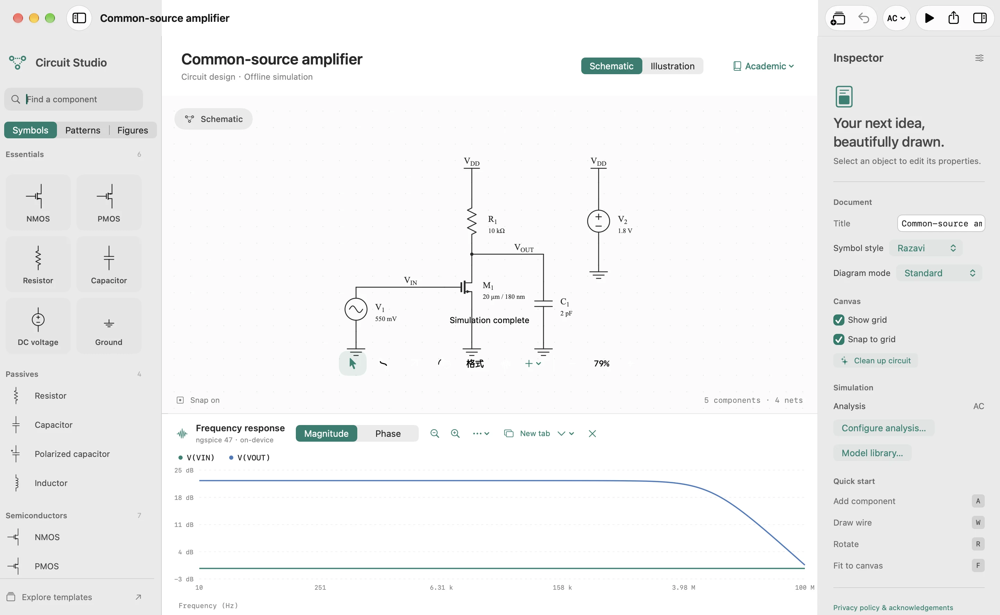
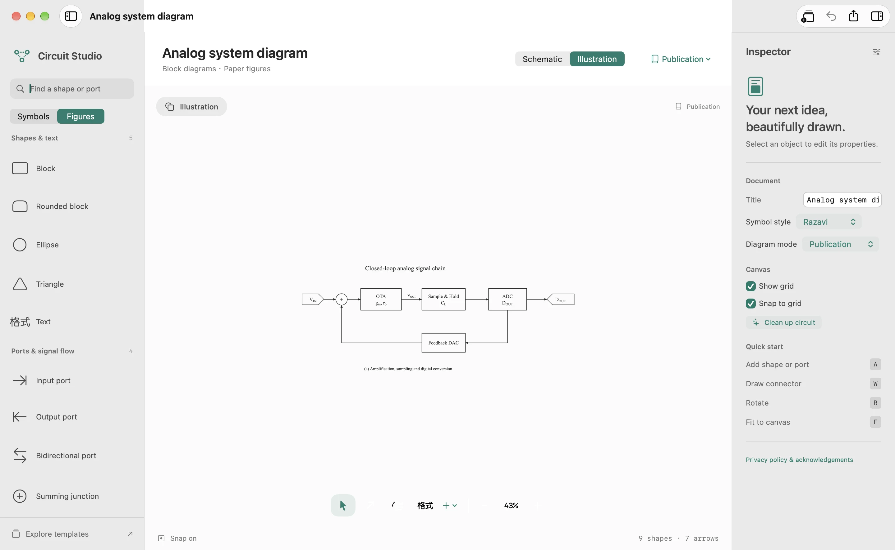

# Circuit Studio

A native Mac canvas for circuit design, offline simulation, and technical illustration.

[Website & Mac download](https://www.weitao-jiang.cn/static/circuit-studio/) · [Releases](https://github.com/CBDT-JWT/CircuitStudio/releases) · [Report an issue](https://github.com/CBDT-JWT/CircuitStudio/issues)



## Two canvas modes

Every new document starts with an empty canvas. Choose the mode in the canvas header:

- **Schematic**: circuit symbols, electrical wires and labels, voltage probes, and embedded ngspice 47 simulation. Operating point, DC, AC and transient analyses run locally.
- **Illustration**: block diagrams and paper figures, with 13 shapes including input/output/bidirectional ports, summing junctions, flowchart shapes, text, and attached arrows. Simulation tools are hidden and SPICE generation is disabled.

Switching modes preserves existing objects. The mode is stored with the document and can be undone. Older documents open automatically; pure figure documents become Illustration and electrical documents remain Schematic.

On Mac, the waveform panel offers **New tab** and **Open in new window**. Each expanded result is a snapshot of that analysis, so further circuit edits and simulations do not change an already-open result. AC magnitude/phase, zoom, cursors, and trace controls remain available.



## Install on Mac

Requires **macOS 26 or later**, on **Apple Silicon or Intel**. Download the universal DMG, open it, then drag **Circuit Studio.app** into **Applications**.

The current direct-download build uses an Apple Development certificate and **is not notarized by Apple**. If macOS blocks it, first attempt to launch the app, then choose **Open Anyway** in **System Settings → Privacy & Security**. See [Apple's instructions](https://support.apple.com/102445). Checksums and signature status are included in each release.

Drawing and simulation run offline, without an account, Homebrew installation, or external simulation executable. Documents are ordinary `.circuit` packages; save them in iCloud Drive if desired. Website downloads require an email address; the developer's server stores that address privately and displays only the number of distinct emails whose installer downloads completed.

## One-click updates

Version 1.2.0 adds Sparkle 2.10.0 updates. Choose **Circuit Studio → Check for Updates…** or use Settings. Automatic checks and background downloads are enabled by default and can be disabled in Settings. When an update is ready, install and relaunch to use it. Existing 1.1.0 installations need one manual download of 1.2.0 to gain the updater.

The app verifies both the update feed and installer with its embedded Ed25519 public key. The private signing key remains in the publisher's local macOS Keychain, under account `circuitstudio-release`. Updates use GitHub Releases over HTTPS, send no system profile, and do not upload circuit documents or simulation data. Direct Mac builds include Sparkle; App Store and iOS builds omit it.

## Mac drafting workflow (1.3.0)

macOS is the primary platform. The native editor follows the drawing interactions and the complete 78-entry inventory of [Analog Canvas](https://github.com/cascode-ai/analog-canvas): continuous placement until Escape, click-to-route wires with editable bends, repeated copy placement, freely movable reference/value labels, box selection of devices/wires/notes, pointer-centred zoom and keyboard manipulation. Chinese and English follow the system language.

The schematic typeface is **Metropolis Bold / Bold Italic**, distributed under its separate Unlicense. The editor model, routing, renderer and interactions are independently implemented in `Engineering/Independent`. Build33 uses the requested matching vector artwork under its separate bundled license; provenance and notices are recorded in `Engineering/Independent/graphics/`. No upstream editor executable code is bundled. Legacy native documents use original native vector primitives. Library sections collapse, remember their state and expand matching sections while searching.

- **I / A**: search components; click repeatedly to place, **Esc** to finish.
- **W**: route wires; click a terminal/wire to finish, click empty space for bends, **Enter** to finish a free endpoint, **Backspace** to remove a bend, **/** to change the corner.
- **R / Shift-R / Command-R**: rotate / mirror horizontally / mirror vertically.
- **T / L / Shift-L**: text / electrical net label / arrow.
- **C / V**: pick and place copies / place the last copy; **Q / E** opens properties.
- **Command-C** puts editable objects, a transparent 3× PNG, and a PDF on the clipboard together. Paste in another circuit to keep editing, or in Office/another image-aware app to use the artwork. **Command-Shift-C** copies only the selected artwork as PNG.
- **Space-drag / middle-drag** pans; trackpad pinch or **Command/Control-wheel** zooms at the pointer. **F / Home** fits the circuit.
- **Circuit → Global supplies…** configures VDD and VSS per document. Matching markers share their net; simulation creates an ideal source automatically. An explicitly drawn source on that net takes precedence.

All 78 reference library entries can be drawn and exported. ADC/DAC, stateful logic, integrators and other blocks without an implemented SPICE model are explicitly reported as unsupported during simulation; drawing support does not imply a physical simulation model.

## Drawing and export

- Vector circuit symbols including MOS, BJT, R/C/L, sources, op amp, supplies and connections.
- Grid snapping, attached endpoints, orthogonal routing, mathematical labels, selection, duplication, undo/redo, alignment and distribution.
- Native document windows and Mac keyboard shortcuts. Use **I / A** to search, **W** to draw wires, **L** for electrical labels, **T** for text, **Shift-L** for arrows, and **F** to fit.
- PDF/SVG vector export; PNG/JPEG/TIFF raster export; CircuitikZ import/export; SPICE netlists in Schematic mode.
- Publication styling, grayscale export, editable system diagrams, flowcharts and device cross-section examples.

The shared SwiftUI application also includes iPhone/iPad layouts. This release's downloadable installer is for macOS.

## iPad compatibility

The shared application retains iPhone/iPad layouts, document compatibility, annotations, laser pointer, eraser and selection tools. Handwriting recognition is deferred and its entry points are hidden. Existing ink remains in documents. macOS keyboard, mouse, clipboard and document-window workflows are the primary development and acceptance target.

## AI assistant and image recognition

The canvas toolbar's **Circuit assistant** opens image recognition and, when the cloud service is configured, circuit explanations. This implementation does not use Apple Intelligence.

- **Offline recognition** uses the bundled experimental Core ML detector and local Vision OCR. The detector is trained on native synthetic symbols; it highlights candidate components and reads text. It does not reconstruct wires, pin roles, rotation or component-value associations, and does not modify the document.
- **Cloud explanation** sends actual component parameters and pin connectivity to the subscription gateway. **Cloud image analysis** sends a normalized JPEG. The gateway uses DeepSeek's `deepseek-flash`, which supports image input according to its [Vision documentation](https://api-docs.deepseek.com/guides/vision/). Interpretations and inferred connections require review; no simulation is performed by an AI request.
- The intended paid plan is **¥8 per month with 200 successful cloud AI answers per subscription month**, shared between explanations and image analysis. Local recognition does not use this allowance. The App Store purchase sheet displays the actual configured storefront price.
- **Redeem code** opens StoreKit's official offer-code flow. The owner generates and privately holds the codes in App Store Connect; code lists and generating credentials never ship in the app. Configure a **Free**, **one-month**, **no auto-renewal** offer for complimentary access, with one-time-use codes. See [Apple's setup instructions](https://developer.apple.com/help/app-store-connect/manage-subscriptions/set-up-subscription-offer-codes/).

The HTTPS gateway is configured at `https://www.weitao-jiang.cn/api/circuit-ai/`, with an owner-only key/settings panel at `/admin`. Successful StoreKit purchase, restore and transaction updates automatically refresh the entitlement and connect to the service. The provider key remains on the server. The ¥8 CNY monthly product has been configured in App Store Connect, but subscription review and a real StoreKit purchase still require validation before public availability.

**CircuitAI** is the engineering workspace assistant. It reads rendered circuit and waveform images alongside topology/numeric data, changes parameters, places/removes parts and connects pins using the original undoable editor transactions, and runs local ngspice. Underspecified goals produce selectable clarification cards with a custom-answer field. Replies render offline Markdown tables, code and KaTeX math. The UI shows connection/execution status without a monthly remaining-count banner. Ground and Cell markers use their native marker placement without device value/reference-display flags. Named VDD/VSS rails have a dedicated CircuitAI tool; optional pin connections use the original editor transactions grouped as one undo step with rollback on failure. The assistant prefers rails plus global supply voltages over unnecessary standalone voltage sources.

Tool workflows have no fixed round cap: the coordinator runs until completion, a clarification, user cancellation or an actual error. Old context is compacted while retaining the current request and complete recent tool/receipt pairs, so the bounded transport window does not become a new round cap. The Stop button remains active. If the provider ignores its single-tool setting and returns a batch, the gateway exposes one validated next action and re-plans from the real receipt/current circuit. Clarification takes priority over edits in mixed batches; omitted calls are never represented as executed. No tool can open files, access the shell, fetch arbitrary URLs or read credentials.

The owner's local **Debug** preview can also connect with a revocable server access code stored in macOS Keychain. The CircuitAI drawer's gear button opens server settings; a new code is validated before replacing the saved connection. Keychain access runs off the main thread. This developer connection is excluded from Release builds, which continue to require a verified App Store subscription. Provider API keys never belong in the app's access-code field.

The relay pairs waveform frequencies with their actual complex values before sending evidence to the assistant. It supplies selected explicit readings and labels interpolated half-power crossings; original full waveforms remain local. This avoids reporting values against the wrong array index.

The live integration harness `scripts/verify_circuitai.py` compiles the actual editor host in an isolated app and reads test endpoint/access-code JSON from stdin. It checks a real RC edit and ngspice solve, image exchange, and an ambiguity-triggered question card. Unit checks need no provider key. This does not verify App Store purchase.

The simulation panel's **共享模型库** contains seven reusable public PDK packets: GF180MCU 180nm 3.3V NMOS/PMOS at TT/FF/SS/FS/SF, and SKY130 1.8V standard/low-threshold NMOS/PMOS at TT. Original BSIM4 coefficients, pinned upstream revisions, SHA-256 hashes and Apache-2.0 licenses are bundled under `Engineering/PDK`. SKY130 wrappers convert geometry from micrometres to SI without changing model coefficients. PMOS LVT needs L≥350nm; GF180 3.3V MOS needs L≥280nm. These open PDK releases are experimental and are not signoff libraries. GF180MCU is GlobalFoundries, not TSMC; TSMC models require an authorized, self-contained user import.

Simulation automatically supplies the matching bundled implementation for supported model bindings. Loading a packet from the library changes only the current project's model text; explicit GF180 migration changes current-Cell MOS bindings and minimum lengths through undoable editor transactions. Imported model text can be named and saved to **我的模型库**, persisted locally under Application Support/CircuitStudio/ModelLibrary for reuse across projects. The limit is 6MB per self-contained `.model`/`.subckt` packet and 50MB/100 entries per local library; external `.include`/control commands remain disabled. There is no automatic cloud sync.

Unsupported missing `.subckt`/`.model` names are reported before ngspice starts. The optional **教学 MOS 模型** button explicitly loads generic Level-1 equivalents with a visible approximation notice. Such results are for functional trends and are not foundry-accurate. `scripts/prepare_gf180_models.py` and `scripts/prepare_sky130_models.py` reproduce the pinned public packets; all seven have passed real native-ngspice inverter DC checks, and GF180 TT additionally passed AC/transient checks.

### Server and subscription setup

`Service/ai_server.py` is a separate gateway on loopback port 5088; the existing download registry stays on port 5087. Install `Service/ai_requirements.txt` in its own virtual environment. Run behind HTTPS nginx using Gunicorn, with `--timeout 120` so Apple verification and the provider request can complete. The external nginx location, for example `/api/ai/`, should strip that prefix when forwarding to this service.

With the server environment loaded, start the gateway using the virtual environment's `gunicorn`:

```sh
gunicorn --chdir Service --bind 127.0.0.1:5088 --workers 2 --timeout 120 'ai_server:create_app()'
```

Keep these values in a server environment file with owner-only permissions, outside the repository:

| Variable | Purpose |
| --- | --- |
| `DEEPSEEK_API_KEY` | Owner's API key; used only on the server |
| `CS_AI_DB` | Private quota database, for example `/srv/circuitstudio-ai/data/usage.sqlite3` |
| `CS_AI_PRODUCT_IDS` | Approved monthly subscription ID, default `com.circuitstudio.app.ai.monthly` |
| `CS_APPLE_ENVIRONMENT` | `Sandbox` for sandbox testing, `Production` for release |
| `CS_APPLE_APP_ID` | Numeric App Store app ID; required in Production |
| `CS_APPLE_BUNDLE_ID` | App bundle identifier, default `com.circuitstudio.app` |
| `CS_APPLE_ROOT_CERTS` | Directory containing trusted Apple root `.cer` certificates from [Apple PKI](https://www.apple.com/certificateauthority/) |
| `CS_APPLE_KEY_PATH` | Server-only In-App Purchase `.p8` key path |
| `CS_APPLE_KEY_ID`, `CS_APPLE_ISSUER_ID` | In-App Purchase server API key identifiers |

The gateway verifies Apple-signed subscription evidence and fetches current subscription status before each AI call. Expired or revoked purchases are refused. A SQLite transaction reserves quota before contacting DeepSeek, limits concurrency, caches answers for idempotent retries, and restores allowance on a failed provider request. Successful answers are cached for at most 24 hours; circuit context and source images are not written to the database. A worker crash leaves a reservation that is retired after three minutes. Requests are limited to 30 per hour per subscription and 200 successful answers per billing period.

Create the monthly auto-renewable product in App Store Connect and set the China storefront price to ¥8. Configure `CIRCUIT_AI_SERVICE_URL` with the HTTPS gateway URL and `CIRCUIT_AI_MONTHLY_PRODUCT_ID` with its product ID in the existing ignored `Release/signing.local.xcconfig` (escape `//` in xcconfig URLs as in the other URL settings). An empty service URL leaves cloud features disabled. Offer-code transactions pass through the same signature, subscription and quota checks as paid transactions. Enable code offers only after testing them in Apple's sandbox. Current UI entitlement checks accept active unexpired subscriptions; billing grace periods are not included in this first implementation.

```sh
python3 -m venv /tmp/circuitstudio-ai-service
/tmp/circuitstudio-ai-service/bin/pip install -r Service/ai_requirements.txt
/tmp/circuitstudio-ai-service/bin/python -m unittest discover -s Service -p 'test_*.py'
```

### Reproduce the small vision model

The training tool uses Xcode's Create ML on an Apple Silicon Mac and needs no Python ML packages. Training images and intermediate outputs are ignored under `build/`.

```sh
python3 scripts/circuit_vision.py dataset build/circuit-vision-data 900
python3 scripts/circuit_vision.py train build/circuit-vision-data build/circuit-vision/CircuitSymbols.mlmodel 1600
python3 scripts/circuit_vision.py evaluate build/circuit-vision-data/test build/circuit-vision/CircuitSymbols.mlmodel build/circuit-vision/test-report.json
python3 scripts/circuit_vision.py evaluate build/circuit-vision-data/templates build/circuit-vision/CircuitSymbols.mlmodel build/circuit-vision/template-report.json
```

Use a fresh dataset directory if the chosen one already exists. The generator includes varied themes, rotations, flips, scales, labels and wire surroundings. The test images are generated separately from training/validation images. The separate template check measures detection in native circuit layouts. Both use native glyphs, so neither establishes accuracy on textbook or paper images. Real diagrams and phone latency/memory measurements are still needed. Model provenance and measured results are recorded in `Resources/Models/model-card.json`.

Bundled model v0.2 is 8,284,326 bytes. At 35% confidence and matching IoU ≥ 0.5, the 180-image synthetic test measures 70.4% precision and 73.8% recall; the five native circuit templates measure 58.1% precision and 64.1% recall. These results justify a read-only experimental preview, not automatic circuit import.

After replacing `Resources/Models/CircuitSymbols.mlmodel`, run `python3 scripts/generate_project.py`. Xcode compiles it into the iOS/Mac bundle. The runtime performs per-class detection followed by suppression of competing labels for the same glyph; candidates below 35% confidence are omitted.

## Build

Use Xcode 27, including its command-line tools. The repository includes prebuilt ngspice static libraries for Mac, iOS and the iOS simulator, with their licenses and pinned source/build instructions.

```sh
xcodebuild -project CircuitStudio.xcodeproj -scheme CircuitStudio \
  -configuration Debug -destination 'platform=macOS' \
  -derivedDataPath /tmp/circuitstudio-build CODE_SIGNING_ALLOWED=NO build

swift test --scratch-path /tmp/circuitstudio-tests
```

The default app uses `DocumentGroup` and opens blank documents. `CIRCUITSTUDIO_PREVIEW` is only for deterministic screenshot and layout checks.

After adding Swift files, regenerate the project with `python3 scripts/generate_project.py`. To rebuild the embedded engine from the pinned upstream source, run `python3 scripts/build_ngspice.py` (requires Xcode and autotools).

## Package a DMG

```sh
python3 -m venv /tmp/circuitstudio-packaging
/tmp/circuitstudio-packaging/bin/pip install dmgbuild==1.6.7
/tmp/circuitstudio-packaging/bin/python scripts/package_macos.py
```

This creates a universal release build, signs Sparkle's nested helpers and the app, verifies the signature and architectures inside the mounted installer, and builds a Finder disk image with an Applications link, background and installation instructions. Files and SHA256 checksums are written to `Release/Direct/`. The default signing choice prefers Developer ID, then Apple Development; a signing certificate is required for the updater.

With a Developer ID Application certificate and an existing notarytool Keychain profile:

```sh
python scripts/package_macos.py \
  --sign-identity 'Developer ID Application: Your Name (TEAMID)' \
  --notary-profile YOUR_EXISTING_PROFILE
```

Credentials and signing overrides belong outside version control. Packaging does not upload to the App Store.

## Publish locally

Publishing runs on the owner's Mac; no GitHub Actions signing secrets are required. Before each release, increase **both** `MARKETING_VERSION` and `CURRENT_PROJECT_VERSION` in `Release/Release.xcconfig`, add `docs/release-VERSION.md`, and commit the source changes. Then run:

```sh
python3 scripts/publish_release.py
```

The command builds the universal DMG, signs and verifies the update feed, pushes the source and version tag, uploads a draft GitHub release, deploys the website and private download service through the existing root SSH connection, then publishes the release. Installed apps discover the new version through the latest release's signed `appcast.xml`. The command checks that the local signing key matches the app's public key and that the build number increases. It keeps up to three update entries with their original release URLs.

Prerequisites: Xcode, `gh` authenticated for this repository, `rsync`, server SSH access, a Mac app signing identity, and the existing Sparkle Keychain key. Sparkle tools are downloaded from a pinned official distribution with SHA256 verification. Preserve the publisher's Keychain through secure Mac backups; changing its trusted signing key requires a planned key transition.

For a previously built and verified DMG, use `--skip-build`. If deployment stops after creating a draft, retry from the same source commit with `--resume --skip-build`. A published version is immutable; use a new version/build for further changes. To notarize a future release, supply `--sign-identity 'Developer ID Application: Your Name (TEAMID)' --notary-profile YOUR_EXISTING_PROFILE`.

## Private download registry

The Linux service uses Flask and Gunicorn behind nginx, bound to `127.0.0.1:5087`. An email submission creates a one-hour download link. The counter counts distinct email addresses after a complete response is streamed; repeat downloads do not increase the number. It is a download metric, not a verified installation count. The website refreshes it every five seconds while visible. Requests are rate limited; email addresses have no public API.

Production files:

- Private database: `/srv/circuitstudio/data/downloads.sqlite3`, accessible to root and the dedicated service account.
- Installers: `/srv/circuitstudio/releases/`, outside the public website directory.
- Service: `circuitstudio-downloads.service`; inspect it with `systemctl status circuitstudio-downloads` and `journalctl -u circuitstudio-downloads`.
- Each deployment backs up the previous website/configuration and a consistent SQLite snapshot in `/srv/circuitstudio/backups/`, preserving the existing contact list.

Export the email list through authenticated SSH, without exposing it on the website:

```sh
ssh -o ClearAllForwardings=yes root@www.weitao-jiang.cn \
  python3 /srv/circuitstudio/service/contacts.py \
  --database /srv/circuitstudio/data/downloads.sqlite3 \
  --output /root/circuitstudio-contacts.csv
scp -o ClearAllForwardings=yes \
  root@www.weitao-jiang.cn:/root/circuitstudio-contacts.csv ./circuitstudio-contacts.csv
```

Add `--downloaded-only` to export only addresses with a completed download. CSV files are created with owner-only permissions. Do not commit an exported list. The website's privacy notice explains what is recorded and how users can request removal; submitting an address does not subscribe it to a mailing campaign.

Run the backend checks with a virtual environment containing `Service/requirements.txt`:

```sh
python -m unittest discover -s Service -p 'test_*.py'
```

## Project structure

| Path | Purpose |
| --- | --- |
| `Sources/CircuitCore` | Document models, geometry, symbols, vector/raster export, connectivity, SPICE and simulation |
| `Sources/CircuitStudio` | Native document app, canvas, inspector, tools and waveform windows |
| `Tests/CircuitCoreTests` | Electrical, geometry, compatibility, export and real simulation checks |
| `scripts` | Project generation, engine builds, editor checks, screenshots, DMG packaging and local publishing |
| `Vendor/ngspice` | Pinned engine, prebuilt XCFramework, build notes and licenses |
| `Vendor/Sparkle` | Pinned Mac updater framework and license |
| `Website` | Static marketing site and actual application captures |
| `Service` | Private email registry, completed download count, CSV export and server installer |

32 core tests and 17 editor interaction checks cover the current release's core behavior. Native UI checks additionally exercise blank startup, mode switching and simulation result tabs/windows. The document format is version 3, with backward compatibility for versions 1 and 2.

## Scope

Simulation supports OP/DC/AC/TRAN and native `.model` / `.param` definitions. XSPICE dynamic code models, OSDI plugins, Noise and Monte Carlo are not included. CircuitikZ import supports the app's own metadata and a limited subset of external numeric-coordinate circuit syntax. Device cross-sections are illustrations. Arbitrary Bézier editing, Visio import, hierarchy, CloudKit conflict handling, Quick Look extensions and full cross-device Handoff validation remain future work.

## License

Application source: [MIT](LICENSE). ngspice and its incorporated third-party code retain their own licenses in [Vendor/ngspice/COPYING](Vendor/ngspice/COPYING). Sparkle retains its license in [Vendor/Sparkle/LICENSE](Vendor/Sparkle/LICENSE). Both notices ship inside the app. Original artwork and asset provenance are documented in [Website/ASSETS.md](Website/ASSETS.md).
